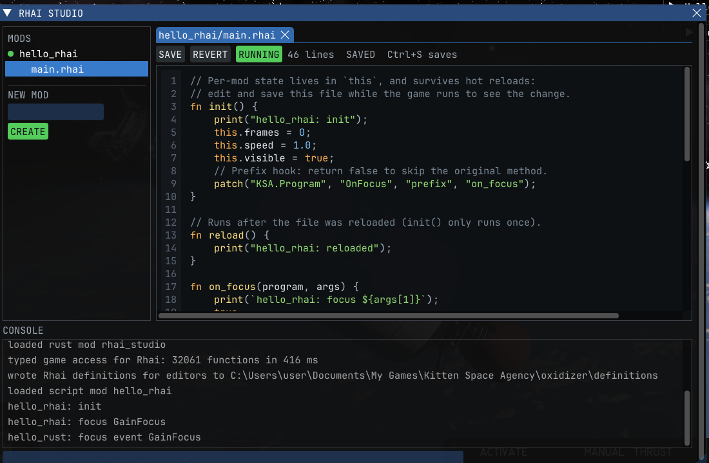

# Rhai Studio

Write [Kitten Space Agency](https://ksa.ahwoo.com) mods inside the game. Rhai Studio is an in-game editor for
[Oxidizer](https://github.com/SafeShows/Oxidizer)'s Rhai mods: open a mod's scripts, change them, press **Ctrl+S**,
and Oxidizer reloads the mod within a second, while you keep flying.



- **Edit:** every installed Rhai mod with its scripts, opened in tabs. Save with Ctrl+S or the Save button; Revert goes
  back to the file on disk. Files changed in another editor are picked up when the tab has no unsaved edits.
- **New mod:** type a name and press Create: Rhai Studio makes `mods/<name>/` with a `mod.toml` and a starter script
  that opens a window, and Oxidizer starts it right away, no restart.
- **Errors:** a mod that fails to load or stops on an error shows the error, with its line, above the editor.
- **Console:** under the editor, the log as it comes in (your `print()` output too) and a line that runs Rhai against
  the live game: `ksa::Program::controlled_vehicle().id`, `let v = ...` and then `v.get_surface_speed()`.

**F9** opens and closes Rhai Studio; it is in the game's **Mods** menu too.

## Install

Needs Oxidizer 0.7.0 or later, as the StarMap mod (`Oxidizer.StarMap`) or standalone; see
[Oxidizer's install steps](https://github.com/SafeShows/Oxidizer#install). Unzip `rhai_studio-X.Y.Z.zip` from the
[releases](../../releases) into `Documents/My Games/Kitten Space Agency/mods/`, so there is a `mods/rhai_studio/`
folder. Windows, Linux and macOS.

## Writing Rhai mods

Oxidizer's [Rhai section](https://github.com/SafeShows/Oxidizer#rhai) lists what scripts can do: the game as typed
modules (`ksa::Program::controlled_vehicle()`), ImGui windows, hotkeys, settings and patching game methods. For
autocomplete in a desktop editor, Oxidizer writes definition files to `<documents>/oxidizer/definitions/`.

The editor colors Rhai (keywords, strings, numbers, comments, calls, `ksa::` modules) and numbers its lines. It is
the game's own ImGui text box underneath, so undo (Ctrl+Z), select all, copy and paste work as usual, and Tab types a
tab. The window follows the game's look: a mod list on the left, filled status labels, the console below.

## Build

Install [Rust](https://rustup.rs), then build and copy the mod into the game's mods folder (quit the game first on
Windows, which keeps the loaded library locked):
```sh
./install.ps1    # Windows
./install.sh     # Linux, macOS
```
It is written with [`oxidizer_api`](https://docs.rs/oxidizer_api): `src/console.rs` shows `rhai_eval` and the log,
`src/files.rs` the files, `src/editor.rs` and `src/highlight.rs` the colored editor (drawn over the game's text
box with ImGui's draw lists, in `src/gfx.rs`), and `src/lib.rs` the window. Pushing a tag like `v1.0.0` publishes a release with
`rhai_studio-1.0.0.zip`, which includes `THIRD-PARTY-NOTICES.txt` for the crates compiled in.

## License

[MIT No Attribution](LICENSE).
