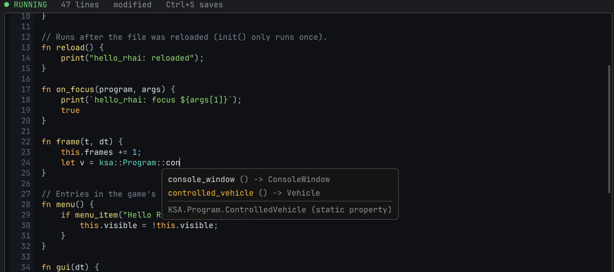
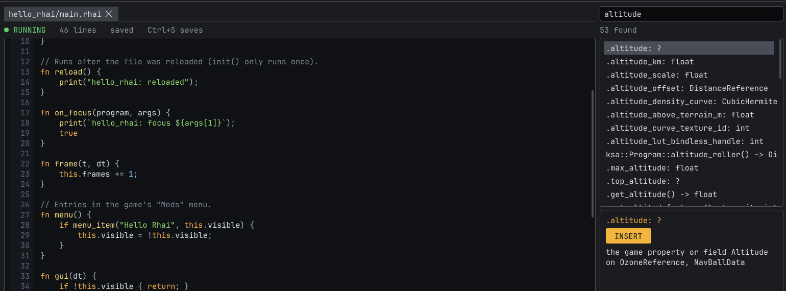
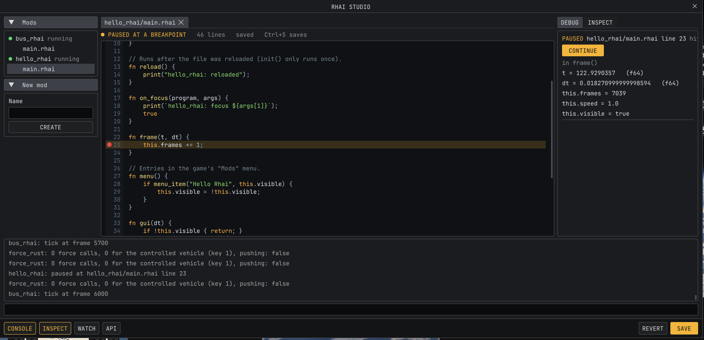
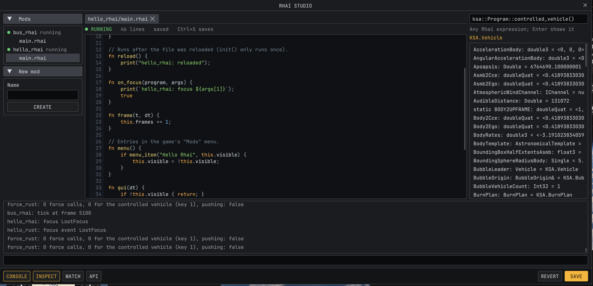
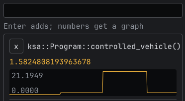

# Rhai Studio

Write [Kitten Space Agency](https://ksa.ahwoo.com) mods inside the game. Rhai Studio is an in-game editor for
[Oxidizer](https://github.com/SafeShows/Oxidizer)'s Rhai mods: open a mod's scripts, change them, press **Ctrl+S**,
and Oxidizer reloads the mod within a second, while you keep flying.


- **Edit:** every installed Rhai mod with its scripts, opened in tabs. Save with Ctrl+S or the Save button; Revert goes
  back to the file on disk. Files changed in another editor are picked up when the tab has no unsaved edits.
- **New mod:** type a name and press Create: Rhai Studio makes `mods/<name>/` with a `mod.toml` and a starter script
  that opens a window, and Oxidizer starts it right away, no restart.
- **Autocomplete:** as you type, suggestions for the game's API (`ksa::Program::con` offers
  `controlled_vehicle() -> Vehicle`), game object members after a dot, Oxidizer's and Rhai's functions, keywords and
  the names your script defines, each with its signature and a line of docs. Up/Down choose, Tab or Enter insert.
- **API explorer:** the API button opens a panel with everything a script can call: search it, open a module
  (`ksa::Universe::`) to see what is in it, read a function's signature and docs, and INSERT it into the script.
- **Breakpoints:** click left of a line number to set one. When the mod reaches it, the DEBUG panel shows the
  function's variables, `this` and the call stack, and the mod pauses while the game keeps running; CONTINUE runs
  it again (in `frame`, one frame at a time). Needs Oxidizer 0.11 or later.
- **Inspector:** the INSPECT button shows the running game object by object: start from any Rhai expression (the
  controlled vehicle by default), click an object to go into it, UP to come back, and click a number, bool or string
  that can be set to change it live. Needs Oxidizer 0.12 or later.
- **Watches:** WATCH evaluates Rhai expressions every frame, shows their values and graphs the numbers
  (`ksa::Universe::get_elapsed_seconds()`), for tuning an autopilot or seeing what the physics does. The list is
  kept between games.
- **Errors:** a mod that fails to load or stops on an error shows the error, with its line, above the editor.
- **Console:** a drawer that slides up from the CONSOLE button under the editor (folded, the bar shows the newest
  line), with the log as it comes in (your `print()` output too) and a line that runs Rhai against
  the live game: `ksa::Program::controlled_vehicle().id`, `let v = ...` and then `v.get_surface_speed()`.

**F9** or **Mods > Rhai Studio** opens and closes Rhai Studio, and the × in its corner closes it. Closed, it is gone
until you open it again, with your tabs as you left them.

### Screenshots

| | |
|---|---|
|  |  |
| Autocomplete | API explorer |
|  |  |
| Breakpoints | Inspector |



## Install

Needs Oxidizer 0.7.0 or later, as the StarMap mod (`Oxidizer.StarMap`) or standalone; see
[Oxidizer's install steps](https://github.com/SafeShows/Oxidizer#install). Unzip `rhai_studio-X.Y.Z.zip` from the
[releases](../../releases) into `Documents/My Games/Kitten Space Agency/mods/`, so there is a `mods/rhai_studio/`
folder. Windows, Linux and macOS.

## Writing Rhai mods

Oxidizer's [Rhai section](https://github.com/SafeShows/Oxidizer#rhai) lists what scripts can do: the game as typed
modules (`ksa::Program::controlled_vehicle()`), ImGui windows, hotkeys, settings and patching game methods. Rhai
Studio's autocomplete and API explorer read the definition files Oxidizer writes to
`<documents>/oxidizer/definitions/` (desktop editors can use them too); they always match your game version.

The editor colors Rhai (keywords, strings, numbers, comments, calls, `ksa::` modules) and numbers its lines. It is
the game's own ImGui text box underneath, so undo (Ctrl+Z), select all, copy and paste work as usual, and Tab types a
tab (except when a suggestion is showing). The window is styled like the game's own dialogs: a centered title, section bars over bordered boxes, and a
footer with the CONSOLE, INSPECT, WATCH and API toggles, REVERT and an amber SAVE.

## Build

Install [Rust](https://rustup.rs), then build and copy the mod into the game's mods folder (quit the game first on
Windows, which keeps the loaded library locked):
```sh
./install.ps1    # Windows
./install.sh     # Linux, macOS
```
It is written with [`oxidizer_api`](https://docs.rs/oxidizer_api): `src/console.rs` shows `rhai_eval` and the log,
`src/files.rs` the files, `src/editor.rs` and `src/highlight.rs` the colored editor (drawn over the game's text
box with ImGui's draw lists, in `src/gfx.rs`), and `src/lib.rs` the window. Pushing a tag like `v1.0.0` publishes a release with
`rhai_studio-1.0.0.zip`, which includes `THIRD-PARTY-NOTICES.txt` for the crates compiled in.

## License

[MIT No Attribution](LICENSE).
